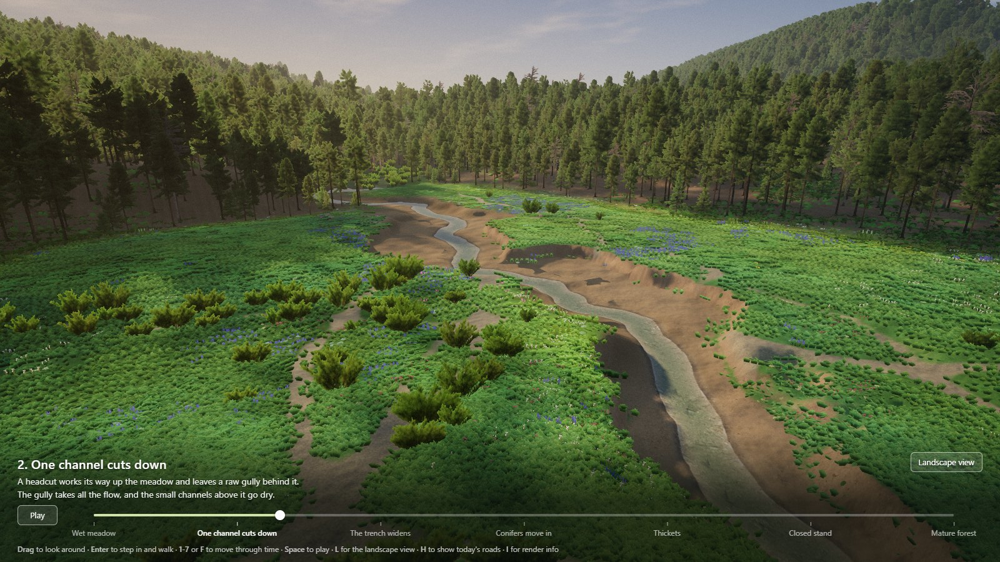
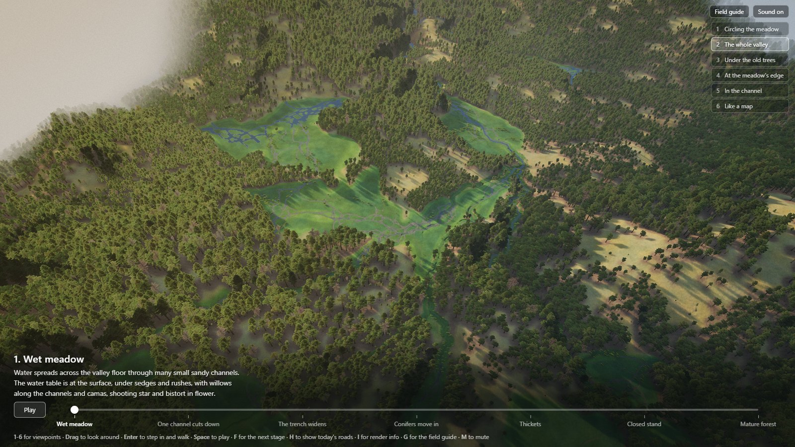

# Meadow render

A browser scene on a real 1 m lidar DEM (Nye Meadow) that tells how a wet
meadow is lost, following the stream evolution models (Schumm's channel
evolution model; Cluer and Thorne's stage 0). The camera slowly circles one
meadow lobe while a timeline at the bottom of the page moves through seven
stages, blending smoothly between them. A landscape view flies out to show
every meadow in the valley going through the same change. Built toward a
"prerendered film, then step in" page. Plain three.js, no build step yet.

1. Wet meadow: water spreads through many small channels; sedge and rush
   sward, willows along the channels
2. One channel cuts down: a headcut climbs the meadow, leaving a narrow trench
   behind it; the small channels below it go dry
3. The trench widens: its banks fail and retreat, leaving a raw floor that
   greens over; the meadow is now a terrace, drying from its edges inward
4. Conifers move in: seedlings follow the drying front; corn lily and grasses
   on ground that is still moist
5. Thickets: dense young pine on the dried ground
6. Closed stand: the thicket thins itself; snags, downed wood, litter
7. Mature forest: closed canopy, open floor; wet meadow only inside the trench

**Live:** <https://adamcummings.net/meadow-timeline/> (a desktop browser with
WebGL 2; about 40 MB to load).







**Not yet:** the film renderer, the hand-off page, the reimagine brushes.

## What is real and what is not

- **Measured:** today's terrain (the incised state), the road-healed terrain
  (ERASER inpainting), flow accumulation, the road mask.
- **Reconstructed by rule of thumb:** everything about the past and the plants.
  The pre-incision surface is today's with channels filled back to the level
  of the flat ground beside them, wherever such ground lies within 4 m above
  the channel. The meadow's small channels are a generated pattern, not read
  from the DEM. Where headcuts start and how fast they climb, meadow extent,
  moisture, where trees and willows stand and when they grow and die are
  plausible, not surveyed. The timeline has no years on it.
- **Roads** are left out of the story: the terrain shown is the road-healed
  one, and trees stand along the roads' lines. H shows today's roads and takes
  those trees away.

## Run

```bash
/usr/bin/python3 -m http.server 8137
```

Then open <http://localhost:8137>.

| Control | Action |
|---|---|
| Timeline track, stage names | drag or click to move through time |
| Play, Space | run the whole story, about ten seconds a stage |
| 1 to 7, F (Shift+F back) | jump to a stage |
| Landscape view, L | fly out to a high circle over all the valley's meadows, and back |
| H | show today's roads (and the surveyed terrain around them) |
| Drag | look around |
| Enter | step in and walk (W A S D, Shift to run, Esc to return to the circling view) |
| I | show which GPU is drawing the scene, the frame rate, resolution and plant density |

On a laptop with two GPUs, Chrome uses the integrated one unless Windows is
told otherwise (Settings > System > Display > Graphics > add Chrome > High
performance), and the scene then runs at about 0.6x resolution. Press I to see
which one is in use.

URL options: `&stage=0..6` (fractions allowed), `?u=0.3` (position around the
circle, paused, for stills), `&orbit=x,z` (circle another spot, metres from the
window's centre), `&radius=`, `&height=`, `&period=` (seconds per circuit),
`&view=landscape` (start in the landscape view), `&tour=stream` (fly down the
stream instead), `&yaw=`, `&pitch=`, `&at=x,z`
(stand at a point), `&look=x,z` (with `at`), `&walk=x,z,heading` (start on
foot), `&roads=1`, `&time=` (freezes
wind and water, with `u=`), `&fog=`, `&exposure=`, `&bloom=`, `&adapt=0`,
`&scale=` (fixed resolution, as rendered pixels per CSS pixel), `&maxscale=`,
`&blend=0` (no blending of frames over time), `&sharpen=`, `&grain=0`,
`&clear=` (metres the circling camera keeps above the treetops), `&info=1`
(start with the I readout showing), `&q=`, `&trees=0`, `&near=0`, `&logs=0`,
`&grass=0`, `&bench=1` (true frame cost).

## Rebuild the data

```bash
/usr/bin/python3 tools/prep_terrain.py     # terrain, zones, trees, logs, flight path: about 90 s
tools/rebuild_assets.sh                    # everything, including the plant and tree pictures: about 6 min
```

`prep_terrain.py` reads the DEMs, flow accumulation and road mask from the
parent repo. Options: `--site`, `--col0/--row0/--size` (the 1 m window),
`--sun-az/--sun-alt`, `--tree-spacing`, `--orbit` (centre of the camera's
circle), `--path-via` (a point the stream flight passes through). Use the system Python: the conda base has no numpy.

`rebuild_assets.sh` also downloads the Poly Haven models (cached in
`~/.cache/meadow_render`, about 2 GB, outside the repo; `raw` is a symlink to
it), renders trees, snags and plants to pictures in headless Chrome on the
discrete GPU, and packs them. It needs the local server running and stops at
the first step that fails. The sun is baked into the tree pictures: after
changing it, run `prep_terrain.py` once with the new values, then this script.

## Screenshots and tests

```bash
tools/shot.sh name="u=0.3&stage=2" cost="u=0.3&stage=4&bench=1"
tools/stages.sh orbit "u=0"                            # one view at all seven stages, plus a contact sheet
```

These drive headless Windows Chrome from WSL (one-time setup: `npm i
puppeteer-core` in `%TEMP%\meadow_tools`) and write to `shots/tmp` (`OUT=`
changes that). `SHOT_GPU=high` uses the discrete GPU. Only `bench=1` frame
times are real. `tools/timeline_test.mjs`, `tools/walk_test.mjs` and
`tools/live.mjs` (how resolution and plant density settle on a GPU), run with
Windows Node from that folder, exercise the timeline controls, walking and the
quality control.

Flicker cannot be seen in a still, so it is measured:

```bash
SHOT_GPU=high tools/flicker.sh run "stage=0"            # 8 places round the circle, 6 consecutive frames each
STAGE_FROM=0.4 tools/flicker.sh play "x=1"              # the same with the timeline playing
/usr/bin/python3 tools/flicker.py shots/tmp/flicker run play
```

`flicker.py` reports the share of pixels that go brighter then darker (or the
reverse) by at least 6 of 255 levels within three frames, which steady motion
rarely does, and writes a map of where. Add `&blend=0` to a run's query to see
the picture without blending over time.

## How it works

- **Timeline** (`shaders.js`, `main.js`): one number, the stage (0 to 6), drives
  everything. Shaders, the tree code and `prep_terrain.py` share the same rules
  (`incised`, `moisture`, `treeNow`).
- **Terrain** (`main.js`, `shaders.js`): a 1024 m window at 1 m and the whole
  DEM at 4 m. Height = road-healed + fill not yet removed - the meadow's small
  channels.
- **Channel evolution**: every incised reach (a run of channel with a terrace
  beside it; 19 in this watershed) gets a headcut, a step in the bed about 9 m
  long with white water on it, that enters at the reach's downstream end and
  climbs at 450 m of channel per stage or faster, so all the meadows are cut
  over the same stage. Behind it the channel is a slot a few metres wide at
  full depth; then the banks retreat sideways, in bays and points, until
  today's trench is exposed. The trench's new floor is raw sediment at first
  and greens over during the following stage, nearest the channel first. The
  small channels (threads) carry water until the headcut passes, then go dry
  and grass over. When the headcut arrives is stored at 16 bits
  (`*_arrive.bin`): at 8 it would climb in jumps.
- **Moisture**: before the capture the whole meadow is wet. After, a drying
  front crosses it from the edges to the channel over about two stages, and
  only the low ground inside the trench stays wet. Channels with no terrace
  beside them are treated as not incised and keep their meadow.
- **Meadow plants** (`grass.js`, `rosettes.js`, `tools/pack_plants.py`,
  `tools/proc_plants.js`): rings of plants around the camera, chosen by
  moisture: sedge with patches of rush where saturated, meadow grass and
  flowers where moist, corn lily on ground that is moist but no longer
  saturated, bunchgrass where dry. On foot they are upright cards: grass and
  flowers from scans; sedge, rush and corn lily modelled in code and rendered
  to pictures the same way. From the air they are clumps seen from above, drawn
  in code and lying on the ground at any angle, because upright cards read as
  rows of strokes from up there. Each kind has its own green, each plant strays
  a little from it, and the meadow's base colour shifts in patches at two
  scales.
- **Willows** (`tools/proc_plants.js`, `prep_terrain.py`): a shrub modelled in
  code and drawn as a picture from eight sides, like a distant tree. Thickets
  stand along the small channels from the start and die back as their ground
  dries; others come up on the raw floor of the trench soon after the banks
  have passed, and are the shrubs of the new floodplain.
- **Trees** (`trees.js`, `neartrees.js`, `prep_terrain.py`): each has a life:
  when it germinates, how tall it can grow, when it dies. Upland forest stands
  throughout. On the terrace a dense cohort germinates as the ground dries, so
  it follows the drying front in from the edges; most die as the stand closes (snags, then
  gone), about one in ten survives to make the mature forest, and firs come up
  underneath late on. Far trees are pictures of scanned trees from eight sides;
  within about 25 m they are real trunks and branches with sprig cards.
- **Tree shade**: baked at stages 3 to 7 and blended between them.
- **Water**: painted on the terrain. Threads run over dark silt; the incised
  channel has a cobble bed and bars.
- **Landscape view**: a second circle, 716 m out and about 500 m up, around
  the middle of the window's meadows, on the same bearing as the first; the
  camera flies between the two in six seconds.
- **Camera**: circles one meadow lobe every 170 seconds, so the whole sequence
  is watched in one place. Its height follows the ground and the tallest trees
  that ever stand near the path, 18 m clear of their tops, smoothed so it rises
  and sinks gently (about 53 to 78 m above the meadow). A tree close under the
  camera fills the frame, rushes through it, and is drawn as a mix of two
  versions of itself.
- **Dead wood** (`logs.js`): logs lie in the upland forest throughout and appear
  on the terrace as the thicket thins.
- **Post** (`post.js`): 4x multisampled HDR; each frame blended with the ones
  before it, reprojected through the depth buffer (temporal anti-aliasing),
  which is what keeps fine foliage from shimmering as the camera moves; bloom,
  exposure that adapts to the view, filmic tone curve, vignette, grain.
- **Quality** (`main.js`): resolution follows the GPU's measured time per
  frame. A strong GPU renders up to twice the screen's resolution and averages
  it down; a weak one drops to 0.62x, and then thins plants (each shrinking
  away, not vanishing) and shortens the range of 3D trees, to hold 30 fps.
- **Nothing pops**: plants grow and shrink at the edge of their ring, where the
  ground stops suiting them and where one kind gives way to another; tree
  pictures dissolve from one side view to the next; the outer plant ring is
  wide enough from the air that a whole meadow lies inside it.

## Known gaps

- Motion has been measured (see flicker above) but not judged by eye from
  here. With blending over time, under 0.1% of pixels flicker per frame from
  the circling view (about 3% without); the cost is a slightly softer picture
  at 1x resolution and below, partly put back by sharpening.
- From the circling view the last stage is all canopy; the wet strip inside
  the trench shows through it only at stages 5 and 6.
- Headcuts start at the downstream end of every incised reach at once and
  climb at a set speed; nothing ties them to a real cause such as a road
  crossing. At the speed Play runs, one passes through the circled meadow in
  about five seconds.
- Willows are pictures at any distance, so they are soft seen from a few
  metres. They are kept off ground the trench will take, since a shrub cannot
  yet fall in with its bank.
- In the landscape view the meadows beyond the 1 m window are drawn from 4 m
  data, with no small channels and no thickets, and the watershed ends at a
  cut edge against the sky. Plants are not drawn that far out; the meadows are
  the ground's own colour.
- Low evening sun puts the trench's east-facing banks, and the pockets behind
  them, in hard shadow. From the air these read as dark patches on the meadow.
- The small channels are noise contours laid along the flow direction. They
  look right from above but do not connect to real inflows.
- The pre-incision surface is a simple fill, and banks retreat by distance
  from the channel's centre line, made ragged by a fixed pattern rather than by
  any model of where banks fail. Where today's valley is confined (no
  terrace), the scene shows no change.
- Cut banks are steep faces of a 1 m height grid: textures stretch on them.
- A few lone trees stand in the wet meadow from the start, on small patches the
  zone rules count as upland.
- Trees grow by scaling, and switch from the sapling picture to the mature one
  at about 9.5 m; that switch can pop. Tree shade between baked stages is a
  blend, so shadows fade in rather than lengthen.
- Corn lily, sedge and rush are modelled from general knowledge of the plants,
  not from specimens; the scanned flowers are not Sierra meadow species.
- Up close the needles are flat sprig pictures. Logs do not block walking.
- The DEM ends at the watershed boundary; beyond it there is only sky.
- At 1600x900 an RTX 4070 laptop GPU settles at 2x resolution and about 9 ms
  a frame. Intel UHD integrated graphics settles at 0.62x and about 35 fps; the
  ground shader is most of its cost. Not tested on a phone.

## Publishing

The site is this repository's `main` branch served by GitHub Pages from the
root (`.nojekyll` keeps Pages from processing it). Commit and push, and the
live page follows within a minute or two. `shots/` (working screenshots) and
`raw` (the downloaded models) are not in the repository.
