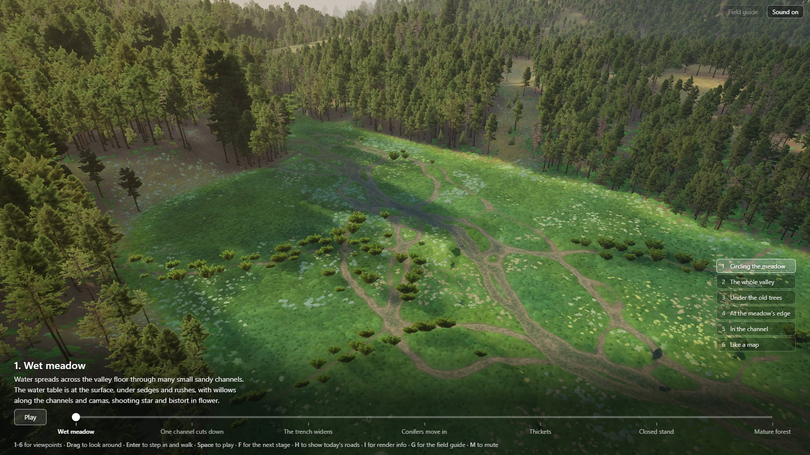
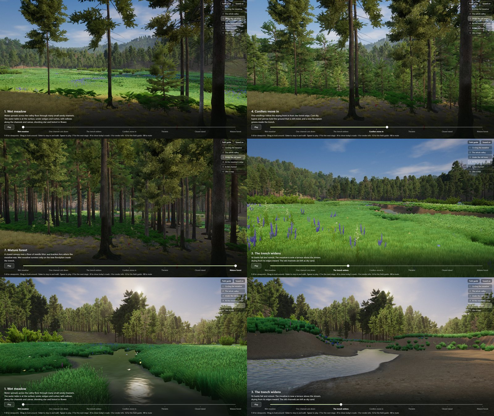

# How a meadow is lost

A browser scene on a real 1 m lidar DEM (Nye Meadow) that tells how a wet
meadow is lost, following the stream evolution models (Schumm's channel
evolution model; Cluer and Thorne's stage 0). A timeline at the bottom of the
page moves through seven stages, blending smoothly between them, and the
change can be watched from six places: circling the meadow, high over the
whole valley, from under the old trees at its edge, from the bank, from in the
channel, and like a map. The sound, the insects and the birds change with it,
and a field guide lists what grows and lives there. Built toward a
"prerendered film, then step in" page. Plain three.js, no build step yet.

1. Wet meadow: water spreads through many small sandy channels; sedge and
   rush sward, willows along the channels, camas, shooting star and bistort
2. One channel cuts down: a headcut climbs the meadow, leaving a raw gully
   behind it; the small channels above it go dry
3. The trench widens: its banks fail and retreat, leaving a bare floor; the
   meadow is now a terrace, drying from its edges inward; the old channels are
   dry sand
4. Conifers move in: seedlings follow the drying front; corn lily, lupine and
   yarrow on ground that is still moist; the trench floor starts to green
5. Thickets: dense young pine on the dried ground, mule's ears in the openings
6. Closed stand: the thicket thins itself; snags, downed wood, litter
7. Mature forest: closed canopy over needle litter and bracken fern; wet
   meadow only inside the trench

**Live:** <https://adamcummings.net/meadow-timeline/> (a desktop browser with
WebGL 2; about 20 MB to load).







**Not yet:** the film renderer, the hand-off page, the reimagine brushes.

## What is real and what is not

- **Measured:** today's terrain (the incised state), the road-healed terrain
  (ERASER inpainting), flow accumulation, the road mask.
- **Reconstructed by rule of thumb:** everything about the past and the plants.
  The pre-incision surface is today's with channels filled back to the level
  of the flat ground beside them, wherever such ground lies within 4 m above
  the channel. The meadow's small channels are routed across that surface from
  where water really enters each meadow to where it leaves, but their exact
  courses are generated. Where headcuts start and how fast they climb, meadow
  extent, moisture, which plants grow where, where trees and willows stand and
  when they grow and die are plausible, not surveyed. The timeline has no
  years on it.
- **The plants are those of a Sierra Nevada meadow** and the forest that
  replaces it, chosen for the story. They are not a survey of this site. The
  trees are generic scanned pines and firs, standing in for lodgepole pine
  (the usual invader of drying Sierra meadows) and the firs that follow it.
- **Roads** are left out of the story: the terrain shown is the road-healed
  one, and trees stand along the roads' lines. H shows today's roads and takes
  those trees away.

## Run

```bash
/usr/bin/python3 -m http.server 8137
```

Then open <http://localhost:8137>.

| Control | Action |
|---|---|
| Timeline track, stage names | drag or click to move through time |
| Play, Space | run the whole story, about ten seconds a stage |
| F or the right arrow (Shift+F, left arrow back) | the next stage |
| 1 to 6, or the list at the right | the six viewpoints (below) |
| G | the field guide |
| M | sound on or off |
| H | show today's roads (and the surveyed terrain around them) |
| Drag | look around |
| Enter | step in and walk (W A S D, Shift to run, Esc to return to the circling view) |
| I | show which GPU is drawing the scene, the frame rate, resolution and plant density |

On a laptop with two GPUs, Chrome uses the integrated one unless Windows is
told otherwise (Settings > System > Display > Graphics > add Chrome > High
performance), and the scene then runs at about 0.6x resolution. Press I to see
which one is in use.

The six viewpoints:

| | Viewpoint | What it shows |
|---|---|---|
| 1 | Circling the meadow | the whole sequence in one place, from above the treetops |
| 2 | The whole valley | every meadow in the window, and the streams that join them |
| 3 | Under the old trees | from the forest at the meadow's edge, looking out: the open meadow fills with trees |
| 4 | At the meadow's edge | from the bank the trench will have, looking across it |
| 5 | In the channel | at the water, as the headcut comes and the bed drops away |
| 6 | Like a map | fixed, from the south, north at the top |

Between the views in the air the camera flies; to and from the ground it cuts.
A visit starts at 3, under the old trees, where the change is most striking.

URL options: `&stage=0..6` (fractions allowed), `?u=0.3` (position around the
circle, paused, for stills), `&orbit=x,z` (circle another spot, metres from the
window's centre), `&radius=`, `&height=`, `&period=` (seconds per circuit),
`&view=meadow|landscape|canopy|rim|channel|plan` (start at that viewpoint),
`&start=0` (no start screen), `&sound=0`, `&hush=pines,brook` (silence
named layers of the sound; the I readout lists what is playing), `&wildlife=0`, `&shafts=` (strength
of the light shafts, 0 for none), `&tour=stream` (fly down the
stream instead), `&yaw=`, `&pitch=`, `&at=x,z`
(stand at a point), `&look=x,z` (with `at`), `&walk=x,z,heading` (start on
foot), `&roads=1`, `&time=` (freezes
wind and water, with `u=`), `&fog=`, `&exposure=`, `&bloom=`, `&adapt=0`,
`&scale=` (fixed resolution, as rendered pixels per CSS pixel), `&maxscale=`,
`&blend=0` (no blending of frames over time), `&sharpen=`, `&grain=0`,
`&clear=` (metres the circling camera keeps above the treetops), `&info=1`
(start with the I readout showing), `&q=`, `&trees=0`, `&near=0`, `&logs=0`,
`&grass=0`, `&bench=1` (true frame cost).

## Rebuild the data

```bash
/usr/bin/python3 tools/prep_terrain.py     # terrain, zones, trees, logs, flight path: about 90 s
tools/rebuild_assets.sh                    # everything, including the plant and tree pictures: about 6 min
```

`prep_terrain.py` reads the DEMs, flow accumulation and road mask from the
parent repo, and writes compact files: 8-bit layers as lossless WebP, 16-bit
grids and the tree list gzipped (the page unpacks them itself, so the download
is the same size on any host). Options: `--site`, `--col0/--row0/--size` (the 1 m window),
`--sun-az/--sun-alt`, `--tree-spacing`, `--orbit` (centre of the camera's
circle), `--path-via` (a point the stream flight passes through). Use the system Python: the conda base has no numpy.

`rebuild_assets.sh` also downloads the Poly Haven models (cached in
`~/.cache/meadow_render`, about 2 GB, outside the repo; `raw` is a symlink to
it), renders trees, snags and plants to pictures in headless Chrome on the
discrete GPU, and packs them. It needs the local server running and stops at
the first step that fails. The sun is baked into the tree pictures: after
changing it, run `prep_terrain.py` once with the new values, then this script.

## Screenshots and tests

```bash
tools/shot.sh name="u=0.3&stage=2" cost="u=0.3&stage=4&bench=1"
tools/stages.sh orbit "u=0"                            # one view at all seven stages, plus a contact sheet
```

These drive headless Windows Chrome from WSL (one-time setup: `npm i
puppeteer-core` in `%TEMP%\meadow_tools`) and write to `shots/tmp` (`OUT=`
changes that). `SHOT_GPU=high` uses the discrete GPU. Only `bench=1` frame
times are real. `tools/timeline_test.mjs`, `tools/walk_test.mjs` and
`tools/live.mjs` (how resolution and plant density settle on a GPU), run with
Windows Node from that folder, exercise the start screen, the timeline
controls, the viewpoints, walking and the quality control.
`tools/sound_test.mjs` renders the sound offline for six situations, prints
each one's loudness and peak and each layer's on its own, and saves them as
WAV files.

Flicker cannot be seen in a still, so it is measured:

```bash
SHOT_GPU=high tools/flicker.sh run "stage=0"            # 8 places round the circle, 6 consecutive frames each
STAGE_FROM=0.4 tools/flicker.sh play "x=1"              # the same with the timeline playing
/usr/bin/python3 tools/flicker.py shots/tmp/flicker run play
```

`flicker.py` reports the share of pixels that go brighter then darker (or the
reverse) by at least 6 of 255 levels within three frames, which steady motion
rarely does, and writes a map of where. Add `&blend=0` to a run's query to see
the picture without blending over time.

## How it works

- **Timeline** (`shaders.js`, `main.js`): one number, the stage (0 to 6), drives
  everything. Shaders, the tree code and `prep_terrain.py` share the same rules
  (`incised`, `moisture`, `treeNow`).
- **Terrain** (`main.js`, `shaders.js`): a 1024 m window at 1 m and the whole
  DEM at 4 m. Height = road-healed + fill not yet removed - the meadow's small
  channels.
- **Drainage** (`prep_terrain.py`): every height in the valley model is
  measured above the channel the ground drains to, not the nearest channel as
  the crow flies (found by a least-climb search outward from the channels on a
  4 m grid). Measuring from the nearest gave the meadows straight seams where
  one channel's territory met another's. Outside the meadows each stream has a
  riparian strip, 3.5 to 11 m either side by drainage area, kept clear of
  conifers and planted with willows: that is what traces the drainage through
  the forest from the air.
- **The meadow's small channels** are routes over the pre-incision surface from
  each place water enters a meadow (the stream, a side drainage) to the
  meadow's outlet, so none starts or stops in the open. That surface is nearly
  level across the valley, so a route is the easiest way over ground made
  uneven at random; four such routings, and branches that leave one channel to
  rejoin lower down, make the network. Their beds are sand: under water until
  the headcut passes, then dry, and taken over by plants and litter only two
  to four stages later. Beyond the 1 m window the same routing is done on the
  4 m grid, so every meadow in the watershed has its channels, drawn a cell
  wide.
- **Channel evolution**: every incised reach (a run of channel with a terrace
  beside it; 17 in this watershed) gets a headcut, a step in the bed about 5 m
  long with white water on it, that enters at the reach's downstream end and
  climbs at 450 m of channel per stage or faster, so all the meadows are cut
  over the same stage. Behind it is a gully 7 m wide at the trench's full
  depth; then the banks retreat sideways, slowly at first, in bays and points,
  to 11 m either side of the channel at most. Where the surveyed trench is
  wider than that, the ground beyond stays at the old meadow's level for good,
  so the scene's final trench is narrower than the survey's. Above each meadow
  the headcut does not stop: it goes on up the channel and its tributaries
  into the forest at the same speed, for five stages in all (9.6 km of forest
  channel in this watershed), leaving a gully 0.8 to 1.7 m deep in a strip a
  few metres wide. There is no terrace in the forest to measure that depth
  from; it is a rule of thumb. Gully and trench floor stay raw sediment
  for one to two and a half stages after the bank has passed, then green over
  from the channel outward: that is the new floodplain. The bank on the sun's
  side casts its shadow across the floor, worked out in the shader, since the
  baked shadows know only the surveyed trench. When the headcut arrives is
  stored at 12 bits (`*_arrive.bin.gz`): at 8 it would climb in jumps.
- **Moisture**: before the capture the whole meadow is wet. After, a drying
  front crosses it from the edges to the channel over about two stages, and
  only the low ground inside the trench stays wet. Channels with no terrace
  beside them are treated as not incised and keep their meadow.
- **Meadow plants** (`grass.js`, `rosettes.js`, `tools/pack_plants.py`,
  `tools/proc_plants.js`): rings of plants around the camera. The sward is
  chosen by moisture: sedge with patches of rush where saturated, meadow grass
  where moist, bunchgrass where dry. On foot they are upright cards: the two
  grasses from scans, everything else modelled in code and rendered to
  pictures the same way. From the air they are clumps seen from above, drawn
  in code and lying on the ground at any angle, because upright cards read as
  rows of strokes from up there. Each kind has its own green, each plant strays
  a little from it, and the meadow's base colour shifts in patches at two
  scales.
- **Wildflowers and understory** (the `FORBS` table in `grass.js`): fourteen
  species, each with the moisture and shade it wants, how thickly it grows and
  a drift pattern, so they come and go with the timeline. Wet meadow: common
  camas (*Camassia quamash*), water-plantain buttercup (*Ranunculus
  alismifolius*), Sierra shooting star (*Primula jeffreyi*), western bistort
  (*Bistorta bistortoides*), elephant's head (*Pedicularis groenlandica*),
  Bigelow's sneezeweed (*Helenium bigelovii*). Moist and drying ground: corn
  lily (*Veratrum californicum*), large-leaved lupine (*Lupinus polyphyllus*),
  giant red paintbrush (*Castilleja miniata*), yarrow (*Achillea
  millefolium*), woolly mule's ears (*Wyethia mollis*). Under and between the
  trees: pinemat manzanita (*Arctostaphylos nevadensis*), bracken fern
  (*Pteridium aquilinum*) and, rarely, snow plant (*Sarcodes sanguinea*). The
  wet-meadow species persist on the floodplain inside the trench. See "Plant
  sources" below for what each placement rests on.
- **Willows** (`tools/proc_plants.js`, `prep_terrain.py`): a shrub modelled in
  code and drawn as a picture from eight sides, like a distant tree. Thickets
  stand along the small channels from the start and die back as their ground
  dries; others come up on the raw floor of the trench soon after the banks
  have passed, and are the shrubs of the new floodplain.
- **Trees** (`trees.js`, `neartrees.js`, `prep_terrain.py`): each has a life:
  when it germinates, how tall it can grow, when it dies. Upland forest stands
  throughout. On the terrace a dense cohort germinates as the ground dries, so
  it follows the drying front in from the edges; most die as the stand closes (snags, then
  gone), about one in ten survives to make the mature forest, and firs come up
  underneath late on. Far trees are pictures of scanned trees from eight sides;
  within about 25 m they are real trunks and branches with sprig cards.
- **The forest is a patchwork**, not an even cover. Around the meadows: stands
  of different ages a few hundred metres across, taller and thicker in the
  draws and on shady slopes than on ridges and sunny ones, trees in clumps
  with gaps between, openings on about a tenth of the ground, a few old giants,
  a young dense skirt along the meadows' edges, pine on the sunny and young
  ground and fir in the shade. Over the lost meadow: glades where the conifers
  never take hold (about a seventh of it), and a stand that grows taller in
  some patches than in others.
- **The forest ages** with the timeline, like the trees that take the meadow.
  Each upland tree has a height at the start and a height it can come to:
  young stands grow up and thin themselves, trees under the canopy are
  released or shaded out, old trees die and stand a while as snags, and new
  trees come up in the openings and under old stands. About two thirds of the
  forest's trees are still growing at the start, a quarter die along the way,
  and canopy cover in the window goes from 54% to 76%.
- **Tree shade**: baked at every stage and blended between them.
- **Water**: painted on the terrain. The small channels run over sand; the
  incised channel has a cobble bed and bars. Far off, a stream is drawn at
  least about a pixel wide so it does not break up.
- **Landscape view**: a second circle, about 530 m out and 640 m up, around
  the middle of the window's meadows, on the same bearing as the first; the
  camera flies between the two in six seconds. It looks down at about 50
  degrees, steep enough to see into the stream corridors. It is the real
  terrain with no vertical exaggeration: the whole lidar DEM of the watershed
  (4.2 by 2.8 km), streams where flow accumulation puts them. The last 220 m
  before the watershed boundary, where the data ends, dissolve into the sky.
- **Viewpoints** (`main.js`, `prep_terrain.py`): the three on the ground are
  chosen from the terrain: in the channel where it has most to cut, on the
  sunward bank just outside what will be cut away, and a dozen metres into
  standing forest where looking back at the meadow is looking toward the sun.
  No tree stands within 2 m of any of them. In the channel the eye follows the
  bed down as it drops.
- **Wildlife** (`wildlife.js`): butterflies over the flowers and dragonflies
  over the water, in a ring that travels with the camera like the plants;
  swallows low over the open meadow; a hawk circling. Each is a body and two
  wings shaped, coloured and flown by the vertex shader from the clock, and
  each follows the timeline: the insects go as the meadow dries, the swallows
  when the trees close in.
- **Sound** (`sound.js`): made as it plays with the Web Audio API; there are no
  sound files. The air is mostly still: wind comes in gusts of a few seconds,
  as noise through filters that open while the gust rises, with quiet between
  (a steady hiss sounds like static, not wind). Running water is a loop built
  once out of bubbles, hundreds of short tones a second that rise in pitch as
  they die away. Grasshoppers are a narrow band of noise in pulses; frogs, a
  blackbird, a sparrow, a chickadee and a
  nuthatch are oscillators with a pitch glide and a loudness curve per note; a
  woodpecker is a roll of short thumps. What is heard depends on the stage, on
  the camera's height, on the canopy overhead and on how near running water
  is, so the wet meadow's chorus thins to wind in the pines as the timeline
  runs.
- **Field guide** (`guide.js`): the plants and animals in the scene, with
  pictures taken from the scene's own atlases; eight rarer meadow specialists
  that are not drawn, each with where it lives; and two species that have not
  been found in the meadows for years and may be extinct.
- **Start screen**: the scene is already running behind it, blurred, so the
  quality has settled before the visitor begins; and the click that begins is
  what browsers require before sound may start.
- **Camera**: circles one meadow lobe every 170 seconds, so the whole sequence
  is watched in one place. Its height follows the ground and the tallest trees
  that ever stand near the path, 18 m clear of their tops, smoothed so it rises
  and sinks gently (about 53 to 78 m above the meadow). A tree close under the
  camera fills the frame, rushes through it, and is drawn as a mix of two
  versions of itself.
- **Dead wood** (`logs.js`): logs lie in the upland forest throughout and appear
  on the terrace as the thicket thins.
- **Post** (`post.js`): 4x multisampled HDR; each frame blended with the ones
  before it, reprojected through the depth buffer (temporal anti-aliasing),
  which is what keeps fine foliage from shimmering as the camera moves; a soft
  glow of light shafts toward the sun, where trees do not block it; bloom,
  exposure that adapts to the view, filmic tone curve, vignette, grain.
- **Quality** (`main.js`): resolution follows the GPU's measured time per
  frame. A strong GPU renders up to twice the screen's resolution and averages
  it down; a weak one drops to 0.62x, and then thins plants (each shrinking
  away, not vanishing) and shortens the range of 3D trees, to hold 30 fps.
  What it settled on is remembered for the next visit on the same GPU.
- **Nothing pops**: plants grow and shrink at the edge of their ring, where the
  ground stops suiting them and where one kind gives way to another; tree
  pictures dissolve from one side view to the next; the outer plant ring is
  wide enough from the air that a whole meadow lies inside it.

## Plant sources

The species were chosen from published descriptions of Sierra Nevada meadows
and forests; where each grows in the scene is a rule of thumb built on them.

- Wet meadows: camas, bistort, water-plantain buttercup, shooting star,
  elephant's head, corn lily, lupine and paintbrush are named for Sierra wet
  meadows and stream banks by the
  [National Park Service's Yosemite wildflower guide](https://www.nps.gov/yose/learn/nature/wildflowerviewing.htm)
  and in [Wild Flowers of the Sierra](https://www.yosemite.ca.us/library/wild_flowers_of_the_sierra/meadows.html).
- Drying: lowered groundwater lets upland plants move onto meadow surfaces
  ([Landscape Ecology, 2023](https://link.springer.com/article/10.1007/s10980-023-01726-7));
  dry meadows carry bluegrass with forbs such as yarrow
  ([NRCS ecological site descriptions](https://edit.jornada.nmsu.edu/catalogs/esd/025X/R025XY004OR/model));
  lodgepole pine is the encroaching conifer
  ([Lubetkin, Westerling and Kueppers](https://escholarship.org/uc/item/5mz3w1wr)).
- Woolly mule's ears grows in open ground between trees, is common in the
  central and northern Sierra, forms solid patches after fire or clearing, and
  is displaced as brush and trees fill in
  ([Las Pilitas](https://www.laspilitas.com/nature-of-california/plants/wyethia-mollis);
  an informal source).
- Lodgepole stands have a sparse understory, with pinemat manzanita among the
  shrubs of their openings
  ([UC forestry notes](https://ucanr.edu/site/forest-research-and-outreach/lodgepole-pine-pinus-contorta)).
- Bracken is among the commonest ferns of Sierra woods and also grows in open
  meadows ([Ferns of the Sierra](https://www.yosemite.ca.us/library/ferns_of_the_sierra/pteridium.html));
  it marks seral forest and does not last past about 200 years
  ([Fire Effects Information System](https://www.fs.usda.gov/database/feis/plants/fern/pteaqu/all.html)),
  which the scene does not model: its bracken stays.
- Snow plant lives on a fungus that lives on conifer roots, so it comes up
  only under conifers
  ([Wikipedia](https://www.wikiwand.com/en/Sarcodes_sanguinea)).
- Not found in a source and placed on general knowledge: Bigelow's sneezeweed
  in moist meadow.

## Field guide sources

- Yosemite toad: [U.S. Fish and Wildlife Service](https://www.fws.gov/species/yosemite-toad-anaxyrus-canorus).
- Sierra Nevada yellow-legged frog: [U.S. Fish and Wildlife Service](https://fws.gov/node/44250).
- Willow flycatcher and great gray owl:
  [Institute for Bird Populations](https://www.birdpop.org/docs/pubs/Wilkerson_and_Siegel_2002_Establishing_a_Southern_Sierra_Meadows_IBA.pdf),
  [National Park Service](https://home.nps.gov/yose/learn/nature/birds.htm).
- Sierra sulphur: [California Conservation Genomics Project](https://www.ccgproject.org/species/colias-behrii-sierra-sulphur-butterfly).
- Sierra Nevada blue: [Butterflies and Moths of North America](https://www.butterfliesandmoths.org/node/1399769),
  [Butterflies of Oregon](https://www.butterfliesoforegon.com/agriades-podarce),
  [UC Davis](https://butterfly.ucdavis.edu/taxonomy/agriades).
- Franklin's bumble bee: [Federal Register listing, 2021](https://www.govinfo.gov/content/pkg/FR-2021-08-24/pdf/2021-17832.pdf),
  [Xerces Society](https://www.xerces-dev.org/sites/default/files/2019-10/sfs-iihy-bombus-franklini.pdf),
  [California Department of Fish and Wildlife](https://wildlife.ca.gov/Data/CNDDB/News/legal-status-of-bumble-bees-in-california).
  It lived in southern Oregon as well as California, and nowhere near the
  Sierra Nevada, so it has no star; and since it has not been found for
  years it is under "Not seen in the meadows now".
- Single-flowered mariposa lily: [California Native Plant Society](https://rareplants.cnps.org/Plants/TaxonReport/46),
  [Calflora](https://calflora.org/app/taxon?crn=1293).
- Considered and left out: the Atossa fritillary (*Speyeria adiaste atossa*),
  an extinct California butterfly, because nothing found says it was a meadow
  species.
- Bolander's clover: [California Native Plant Society](https://rareplants.cnps.org/Plants/TaxonReport/1527).
- Yosemite bog orchid: [North American Orchid Center](https://goorchids.northamericanorchidcenter.org/species/platanthera/yosemitensis/).

The animals named for the sounds (treefrog, blackbird, sparrow, chickadee,
nuthatch, woodpecker) and the swallows and hawk are likenesses, not records
from this site.

## Ideas borrowed

[Abyssal Garden](https://github.com/Noniv/abyssal-garden) (MIT) is where the
numbered viewpoints, sound made in code, simple animals flown by the shader,
the running scene behind the start screen and remembering the settled quality
came from as ideas. None of its code is used here.

## Known gaps

- The sound has been rendered and measured (levels, and its structure in
  spectrograms) but not listened to by its author. Expect it to need tuning by
  ear.
- The animals are a few triangles each: readable as what they are from some
  metres off, no more. Birds are drawn larger than life to be seen at all.
- Motion has been measured (see flicker above) but not judged by eye from
  here. With blending over time, under 0.1% of pixels flicker per frame from
  the circling view (about 3% without); the cost is a slightly softer picture
  at 1x resolution and below, partly put back by sharpening.
- From the circling view the last stage is all canopy; the wet strip inside
  the trench shows through it only at stages 5 and 6.
- Headcuts start at the downstream end of every incised reach at once and
  climb at a set speed; nothing ties them to a real cause such as a road
  crossing. At the speed Play runs, one passes through the circled meadow in
  about five seconds.
- Willows are pictures at any distance, so they are soft seen from a few
  metres. They are kept off ground the trench will take, since a shrub cannot
  yet fall in with its bank.
- In the landscape view the meadows beyond the 1 m window are drawn from 4 m
  data: their small channels are 4 m wide, they have no thickets, and where a
  meadow straddles the window's edge its channels do not line up across it.
  Plants are not drawn that far out; the meadows are the ground's own colour.
- The flowers are all in bloom at once, at every stage: there are no seasons.
- Low evening sun puts the trench's east-facing banks, and the pockets behind
  them, in hard shadow. From the air these read as dark patches on the meadow.
- The pre-incision surface is a simple fill, and banks retreat by distance
  from the channel's centre line, made ragged by a fixed pattern rather than by
  any model of where banks fail.
- The trench is held to 22 m wide, which is narrower than the survey shows in
  places: about 40% of the ground the survey has below terrace level stays up.
  The forest gullies' depth is invented, and the willows that line a forest
  stream only come in after its gully has cut, which is backwards.
- Cut banks are steep faces of a 1 m height grid: textures stretch on them.
- A few lone trees stand in the wet meadow from the start, on small patches the
  zone rules count as upland.
- Trees grow by scaling, and switch from the sapling picture to the mature one
  at about 9.5 m; that switch can pop. Tree shade between baked stages is a
  blend, so shadows fade in rather than lengthen.
- The plants built in code are modelled from general knowledge of each
  species and from plant lists for Sierra Nevada meadows, not from specimens,
  and where each grows is a rule of thumb (see the `FORBS` table).
- Up close the needles are flat sprig pictures. Logs do not block walking.
- The DEM ends at the watershed boundary; beyond it there is only sky.
- At 1600x900 an RTX 4070 laptop GPU settles at 2x resolution and about 8 ms
  a frame. Intel UHD integrated graphics settles at 0.62x and about 32 fps,
  with plants thinned to about 70% in the open meadow; the ground shader is
  most of its cost. Not tested on a phone.
- The page loads about 20 MB before it shows anything, and another 4 MB (the
  full meshes for close-up trees) once it is running; until those arrive, a
  visitor who steps in at once sees nearby trees as flat pictures.

## Publishing

The site is this repository's `main` branch served by GitHub Pages from the
root (`.nojekyll` keeps Pages from processing it). Commit and push, and the
live page follows within a minute or two. `shots/` (working screenshots) and
`raw` (the downloaded models) are not in the repository.
